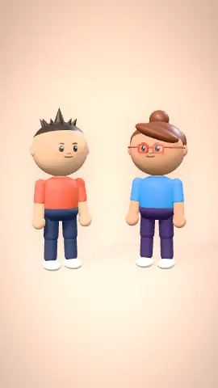
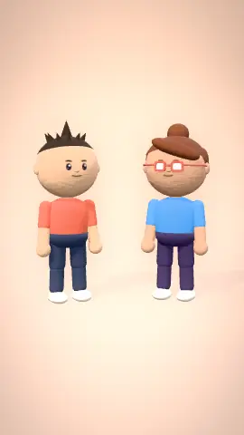
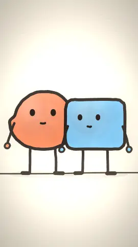
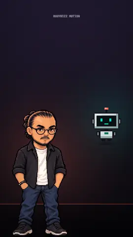
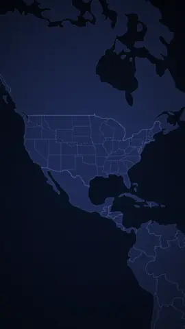
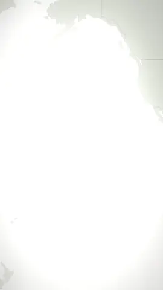

<div align="center">

<h1>
  <picture>
    <source media="(prefers-color-scheme: dark)" srcset=".github/logo/logo-dark.svg">
    
  </picture>
</h1>

**Cinematic motion graphics, rendered from code.**

Kinetic typography · 3D titles · world map flights · 3D & hand-drawn character stories · your own mascot as host · lower thirds, captions & chat stories · sepia history docs · code-made music — <br>
with real camera moves, 20 shader transitions, film-grade colour and motion blur.

[](https://github.com/Rudywizz/rudywizz-motion/actions/workflows/ci.yml)
[](https://www.npmjs.com/package/rudywizz-motion)
[](LICENSE)


**A CLI and a set of agent skills.** One command → an MP4, a transparent MOV/WebM for your editor, a GIF or an animated WebP.<br>
No After Effects, no templates to buy, no AI video model: every frame is drawn by code, so every render is exact and repeatable.

**[Website & live gallery](https://rudywizz.github.io/rudywizz-motion/)** · [Gallery](#gallery) · [Install](#install) · [Quick start](#quick-start) · [Templates](#templates) · [Agents](#use-it-from-claude-code-or-any-agent) · [Reference](#reference) · [Türkçe](README.tr.md)

</div>

---

## Gallery

39 styles. Every preview below is a real render from `npm run gallery`.

### Kinetic typography

| | | |
|:-:|:-:|:-:|
| <br>**word-stack** | <br>**glitch-title** | <br>**scramble** |
| <br>**ticker-rows** | <br>**typewriter** | <br>**highlight-quote** |
| <br>**beat-cut** | <br>**lyric-video** | <br>**murmuration** |
| <br>**neon-sign** | <br>**inflate** | <br>**ink-bleed** |
| <br>**halftone-press** | <br>**led-marquee** | <br>**split-flap** |
| <br>**vhs-memory** | <br>**pixel-quest** | <br>**signal-tune** |

### 3D

| | | |
|:-:|:-:|:-:|
| <br>**extrude-3d** | <br>**cube-spin** | <br>**particle-sphere** |
| <br>**text-tunnel** | <br>**retro-grid** | <br>**card-carousel** |

Any style can also be put in 3D space with a camera: `--camera orbit`, `tilt-reveal`, `tilt-left`, `vertigo`…

### Social & broadcast

| | | |
|:-:|:-:|:-:|
| <br>**lower-third** | <br>**chat-story** | <br>**bar-chart** |
| <br>**countdown** | <br>**cta-follow** | <br>**captions** |
| <br>**odometer** | <br>**receipt** | <br>**orbit-ring** |

Add `--alpha --out name.mov` and drop the result straight onto your footage in Premiere, Final Cut, DaVinci Resolve or CapCut.

### Stories & hosts

| | | |
|:-:|:-:|:-:|
| <br>**story-3d** · vinyl | <br>**story-3d** · clay | <br>**story-3d** · bricks |
| <br>**doodle-story** | <br>**presenter** · your mascot + Bit |  |

Write a script (`Ece [think]: …`) and characters act it out: camera shots, gestures, lip sync to your voice files. Draw your own pixel mascot and it hosts your videos.

### Maps, history & your images

| | | |
|:-:|:-:|:-:|
| <br>**map-route** · globe | <br>**map-route** · any country (US states) | <br>**map-route** · Japan |
| <br>**map-route** · atlas | <br>**map-route** · Türkiye | <br>**20 transitions** |
| <br>**image** · `--look engrave` | <br>**history-title** | <br>**parchment-letter** |
| <br>**image** · `--look sketch` |  |  |

## Why it looks better than "text animation" repos

| | |
|---|---|
| **Deterministic, frame-perfect** | Each frame is computed at `t = frame / fps` and piped to ffmpeg. No screen recording, no dropped frames; same seed → same video (checked in CI). |
| **A real compositor** | Every scene renders to its own canvas, then a WebGL2 pipeline adds the camera, transitions, bloom, lens, chromatic aberration, light leaks, film damage and a colour grade. |
| **Camera with motion blur** | 19 camera moves (punch-in, whip, orbit, tilt-reveal, vertigo, beat-punch…). Fast moves blur like a real shutter. |
| **20 shader transitions** | whip, zoom-through, film burn, ink, liquid, glitch, cube, iris, light leak… |
| **Every format** | 9:16, 1:1, 4:5, 16:9 at any size. Text is fitted, wrapped and hyphenated so it never leaves the frame. |
| **Offline maps** | Globe, world map and a close-up of any country with its states or provinces (Natural Earth). Type place names in ~25 languages — `"München"`, `"Londres"`, `"Portland, Maine"` — get a flight. |
| **Code-made music** | `--music upbeat` (or `chill`, `retro`, `cinematic`) writes an original backing track for the exact length of your video, from code: no samples, no licences, no copyright claims. It ducks under voice lines. `rudywizz-motion music chill --duration 30` saves it as a .wav. |
| **Your footage** | Clips and photos get speed ramps, handheld camera, captions, parallax layers and grades. |
| **Unicode first** | All 17 bundled fonts cover Latin Extended (ğ ş ı İ ç ö ü, ä ø ß é ł…); casing is locale-aware (`i → İ`). |

## Install

Needs **Node 18+** and **ffmpeg** (macOS `brew install ffmpeg` · Windows `winget install ffmpeg` · Linux `sudo apt install ffmpeg`).

**CLI from npm** (no clone)
```bash
npm install -g rudywizz-motion
rudywizz-motion doctor              # uses your installed Chrome/Edge, or: npx playwright install chromium
rudywizz-motion render neon-sign --text "Hello"
```

**CLI from source**
```bash
git clone https://github.com/Rudywizz/rudywizz-motion && cd rudywizz-motion
npm install
npx playwright install chromium     # one-time; or use your installed Chrome/Edge
npx rudywizz-motion doctor          # Node ✓  ffmpeg ✓  browser ✓  WebGL2 ✓
```

**Claude Code plugin**
```text
/plugin marketplace add Rudywizz/rudywizz-motion
/plugin install rudywizz-motion@rudywizz
```

**Any agent that reads skills** (Claude Code, Codex, Cursor…)
```bash
npx skills add Rudywizz/rudywizz-motion
```

## Quick start

```bash
npx rudywizz-motion render glitch-title --text "Signal / lost" --grade cyber
npx rudywizz-motion render extrude-3d --text "Big / news" --format 16:9
npx rudywizz-motion render lower-third --text "Deniz Aydın / Host" --alpha --out name.mov
npx rudywizz-motion render map-route --set 'route=["Paris","Rome","Istanbul"]' --text "Summer trip"
npx rudywizz-motion render image --image portrait.jpg --look engrave --grade sepia --film 0.6
npx rudywizz-motion render stats-recap          # a whole template
npx rudywizz-motion preview neon-sign           # live loop in your browser
```

Draft fast with `--size 540`, then render the final at the default 1080.

> **Windows (PowerShell / cmd):** quoting JSON on the command line is painful. Put the options in a file and pass
> `--params opts.json`, or write a composition with `npx rudywizz-motion init`.

## Templates

`npx rudywizz-motion templates` lists them; render one by name, or copy its JSON and edit it.

| Template | What | Format |
|---|---|---|
| `showreel` | The hero above: kinetic type, 3D, maps and transitions | 16:9 |
| `kinetic-promo` | Glitch open → justified word stack → decoder → scrolling poster rows | 9:16 |
| `3d-title` | Extruded title → spinning cube → particle sphere → synthwave sign-off | 16:9 |
| `youtube-intro` | Decoder title → word stack → host lower third | 16:9 |
| `stats-recap` | Countdown → big rolling number → bar chart race → follow button | 9:16 |
| `chat-reel` | A chat plays out → glitch plot twist → follow CTA | 9:16 |
| `quote-card` | Editorial quote with a marker sweep | 4:5 |
| `event-countdown` | 3·2·1 → departures board with date and place → neon sign-off | 9:16 |
| `travel-reel` | Globe flight → departures board → distance counter → neon sign-off | 9:16 |
| `history-short` | Sepia documentary: year card → atlas → engraving → letter | 9:16 |
| `lyric-teaser` | On-beat stamped words → lyric lines → VHS outro (bring your track) | 9:16 |
| `launch` | TV tune-in → orbiting feature rings → chrome reveal → risograph sign-off | 9:16 |
| `tour` | 30 s tour of the original styles | 9:16 |
| `black-friday` | Sale ad: glitch open → LED price boards → rolling discount → receipt → deadline countdown | 9:16 |
| `new-year` | New Year countdown: departures board → 3·2·1 → particle year → neon greeting | 9:16 |
| `youtube-outro` | End screen: thanks → subscribe click with confetti → 12 s clean space for YouTube's end-screen cards | 16:9 |
| `birthday` | Birthday wish: group-chat surprise → chrome balloon letters → age counter → personal note | 9:16 |
| `save-the-date` | Wedding invitation: letter writes itself → date & place board → map to the venue | 9:16 |
| `podcast-clip` | Podcast / interview clip: episode title → pull quote → word-by-word captions + guest lower third | 9:16 |

### Made with itself

The launch videos in [`promo/`](promo/) are plain compositions: a 16:9 YouTube video, a Turkish Instagram reel and an English Short.
```bash
npx rudywizz-motion render promo/youtube-promo.json --out promo.mp4
```

## Reels from your footage

```json
{
  "$schema": "https://raw.githubusercontent.com/Rudywizz/rudywizz-motion/main/skills/rudywizz-motion/schema/composition.schema.json",
  "look": { "grade": "teal-orange", "bloom": 0.3, "leak": 0.2, "grain": 0.04 },
  "scenes": [
    { "style": "map-route", "route": ["Istanbul", "Kaş"], "duration": 5,
      "transition": { "type": "whip", "duration": 0.45 } },
    { "clip": "drone.mp4", "in": 4, "duration": 3, "speed": "ramp-mid", "camera": "punch-in",
      "overlay": { "style": "captions", "text": "Kaş, Antalya" },
      "transition": { "type": "burn", "duration": 0.8 } },
    { "layers": [ { "src": "sky.png", "depth": 0 }, { "src": "me.png", "depth": 1 } ],
      "duration": 3, "camera": "orbit" },
    { "style": "neon-sign", "text": "See you / soon", "duration": 3 }
  ]
}
```
```bash
npx rudywizz-motion render reel.json --audio song.mp3 --out reel.mp4   # your song
npx rudywizz-motion render reel.json --music upbeat --out reel.mp4     # or music made by code
```
The `$schema` line gives you autocomplete and inline docs for every style option in VS Code and other editors.
Typos are caught before rendering: `unknown camera "orbt". Did you mean "orbit"?`

## Use it from Claude Code (or any agent)

After installing the plugin, just ask:

> *make a 15s reel from these clips with a map intro Istanbul → Rome*<br>
> *a 16:9 YouTube intro for my channel "Build Weekly", glitchy, then a lower third with my name*<br>
> *a bar chart race of these numbers, vertical, with a follow button at the end*

Or call a skill directly: `/rudywizz-motion:glitch-title Signal lost`, `/rudywizz-motion:reel`, `/rudywizz-motion:history-video 1453`.
The agent checks stills before rendering, so layout problems are caught early.

## Reference

```text
rudywizz-motion list | templates | doctor | init [file] | --version
rudywizz-motion render  <style|template|comp.json|image|clip> [options]
rudywizz-motion still   <…> --at <seconds>
rudywizz-motion preview <…>
```

| Option | |
|---|---|
| `--text` | Text (`" / "` or `\n` for line breaks) |
| `--image` / `--clip` | Animate your own media |
| `--set key=value` · `--params file.json` | Style options (JSON values ok) |
| `--camera` | `static drift push-in pull-out punch-in crash-zoom whip-from-left whip-from-right whip-from-top spin-in rise orbit tilt-reveal tilt-left tilt-right vertigo handheld float beat-punch` |
| `--look` | `engrave sketch oldphoto duotone halftone posterize noir` |
| `--grade` | `teal-orange kodak fuji sepia noir bleach cyber sunset matte` |
| `--bloom --grain --leak --film --aberration --vignette` | Post effects, 0–1 |
| `--motion-blur n` | Sub-frames per frame (4–8 = filmic) |
| `--format` · `--size` | `9:16` (default) `1:1` `4:5` `16:9` · short side in px |
| `--out` | `.mp4` · `.mov` (ProRes 4444 + alpha) · `.webm` (VP9 + alpha) · `.gif` · `.webp` |
| `--music` | Code-made music: `upbeat` `chill` `retro` `cinematic` |
| `--alpha` · `--audio` · `--bpm` · `--lang` · `--seed` · `--fps` · `--duration` · `--strict` | |

Transitions: `fade flash dip whip zoom spin glitch ink burn liquid iris wipe blinds pixelate leak cube ripple doors stretch luma`.
Full composition schema and the agent workflow: [`skills/rudywizz-motion/SKILL.md`](skills/rudywizz-motion/SKILL.md).

## How it works

```text
composition JSON ──► timeline (scenes, overlaps, speed ramps)
                         │
   style.js / image / clip ──► 2D canvas per scene  (fonts, data, layout)
                         │
                 WebGL2 compositor
   look filter ─► camera (+ camera blur) ─► transition ─► bloom ─► grade/lens/film/grain
                         │
        headless Chromium, frame by frame ──► ffmpeg ──► mp4 / mov / webm / gif / webp
```
Roughly 0.2–0.5 s per 1080p frame on a laptop. Draft with `--size 540`.

## Safe to run

- **No network, no telemetry.** Nothing is uploaded or downloaded while rendering; fonts, maps and data ship in the repo.
- **One dependency** (Playwright, by Microsoft). The engine is plain, readable JavaScript with no build step.
- The render server listens on `127.0.0.1` only, behind a random per-run token, and stops when the render ends.
- Details and private vulnerability reporting: [SECURITY.md](SECURITY.md).

## Add a style

A style is one file, `skills/rudywizz-motion/styles/<id>/style.js`:
```js
export default {
  id: 'my-style', title: 'My Style', tagline: 'One line about it',
  fonts: [['Fraunces', 900]],
  defaults: { text: 'Hello', duration: 5, ink: '#fff' },
  options: { ink: 'Text colour' },
  setup(api) { /* layout once, return state */ },
  frame(api, t, state) { api.bg('#111'); /* draw frame at time t with api.ctx */ },
};
```
Then `npm run skills` generates its agent skill and schema entry, and `npm test` checks it in every format.
See [CONTRIBUTING.md](CONTRIBUTING.md). Ideas are welcome in [issues](https://github.com/Rudywizz/rudywizz-motion/issues/new/choose).

## Roadmap

- [x] Publish to npm (`npm install -g rudywizz-motion`)
- [ ] `.srt` import for `captions` and `lyric-video`
- [ ] Automatic BPM detection from `--audio`
- [ ] Parallel frame rendering
- [ ] More map regions and languages

If rudywizz-motion saves you an evening in After Effects, a ⭐ helps other people find it.

## Credits & license

Made by [Rudywizz](https://github.com/Rudywizz). Code: [MIT](LICENSE) — free for personal and commercial use.
Fonts: SIL OFL via Fontsource. Maps: Natural Earth (public domain) via world-atlas. Projections: d3-geo.
Demo illustrations and gallery media are CC0. Full list: [THIRD_PARTY_NOTICES.md](THIRD_PARTY_NOTICES.md).
Use images and clips you have the rights to.
