<div align="center">

# rudywizz-motion

**Cinematic motion graphics, rendered from code.**
Kinetic type · map route animations · sepia history docs · reels from your own clips —
with real camera moves, 20 shader transitions, film-grade colour and motion blur.

Works as **Claude Code skills** (`/neon-sign "Still awake"`, `/reel`, `/history-video`) or as a plain **CLI**.
No After Effects. No templates to buy. No AI video model — every frame is drawn by code, so every render is exact and repeatable.

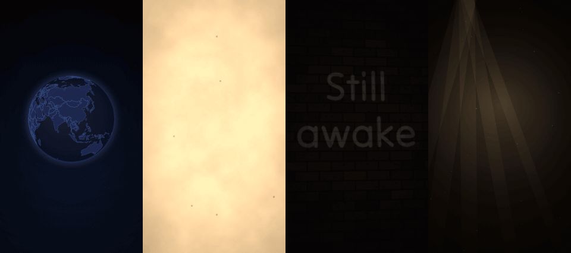

[Install](#install) · [Gallery](#gallery) · [Maps](#maps) · [History pack](#history-pack) · [Reels from your footage](#reels-from-your-footage) · [Reference](#reference) · [Türkçe](README.tr.md)

</div>

---

## Why it looks better than "text animation" repos

| | |
|---|---|
| **Deterministic, frame-perfect** | Each frame is computed at `t = frame / fps` and piped to ffmpeg. No screen recording, no dropped frames, same seed → same video. |
| **A real compositor** | Every scene renders to its own canvas, then a WebGL2 pipeline adds the camera, transitions, bloom, lens, chromatic aberration, light leaks, film damage and a colour grade. |
| **Camera with motion blur** | 19 camera moves (punch-in, whip, orbit, tilt-reveal, vertigo, beat-punch…). Fast moves blur like a real shutter; optional sub-frame motion blur for everything else. |
| **20 shader transitions** | whip, zoom-through, film burn, ink, liquid, glitch, cube, iris, light leak… |
| **Offline maps** | Globe, world and Turkey's 81 provinces from Natural Earth. Type place names, get a flight. |
| **History pack** | Any portrait or painting draws itself as an ink engraving, then washes in sepia. Gilded year cards, antique atlases, letters that write themselves. |
| **Your footage** | Drop in clips and photos; get speed ramps, handheld camera, captions, parallax layers and grades. |
| **Unicode / Turkish first** | All 17 bundled fonts cover ğ ş ı İ ç ö ü; casing is locale-aware (`i → İ`). |

## Install

**Claude Code (plugin)**
```text
/plugin marketplace add Rudywizz/rudywizz-motion
/plugin install rudywizz-motion@rudywizz
```

**Any agent that reads skills** (Claude Code, Codex, Cursor…)
```bash
npx skills add Rudywizz/rudywizz-motion
```

**Plain CLI**
```bash
git clone https://github.com/Rudywizz/rudywizz-motion && cd rudywizz-motion
npm install
npx rudywizz-motion doctor        # ffmpeg ✓  browser ✓  WebGL2 ✓
```
Needs Node 18+ and ffmpeg. If the browser check fails: `npx playwright install chromium`.

## 30-second start

```bash
npx rudywizz-motion render neon-sign --text "Still / awake" --camera orbit --grade teal-orange --bloom 0.4
npx rudywizz-motion render map-route --set 'route=["İstanbul","Kapadokya","Antalya"]' --text "Rota"
npx rudywizz-motion render image --image portrait.jpg --look engrave --grade sepia --film 0.6
npx rudywizz-motion render tour      # the 30-second showreel above
```
In Claude Code just ask: *"make a 15s reel from these clips with a map intro İstanbul → Roma"* or type `/history-video 1071 Malazgirt`.

## Gallery

Every preview below was rendered by `node scripts/build-gallery.mjs` with the default settings.

| | | |
|:-:|:-:|:-:|
| 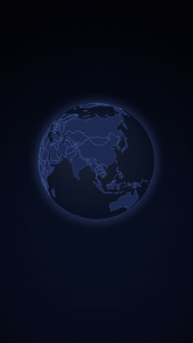<br>**map-route** · globe | 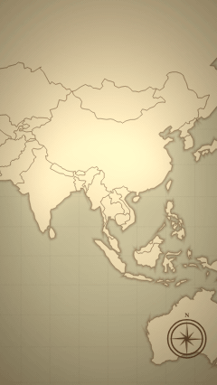<br>**map-route** · atlas | 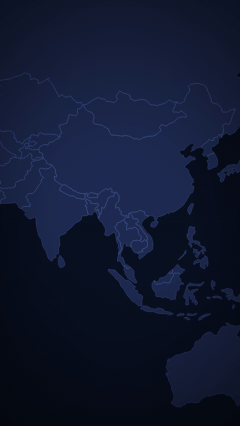<br>**map-route** · Turkey |
| 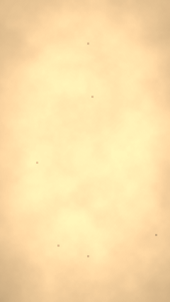<br>**image** · `--look engrave` | 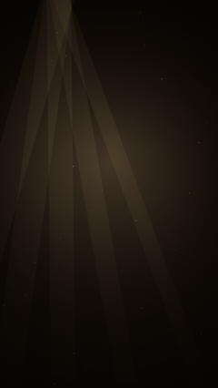<br>**history-title** | 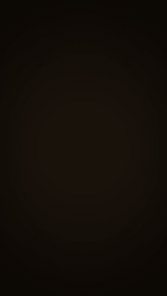<br>**parchment-letter** |
| 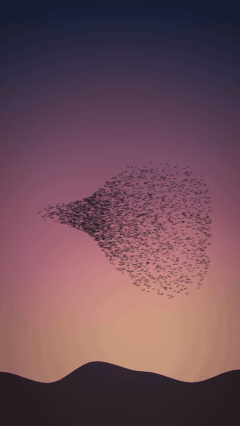<br>**murmuration** | 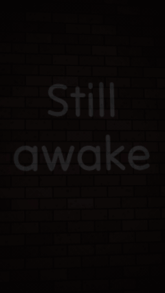<br>**neon-sign** | 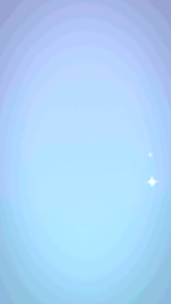<br>**inflate** |
| <br>**ink-bleed** | <br>**halftone-press** | 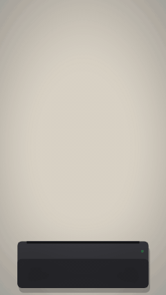<br>**receipt** |
| 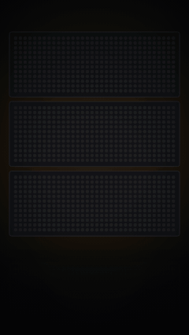<br>**led-marquee** | 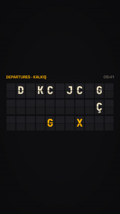<br>**split-flap** | 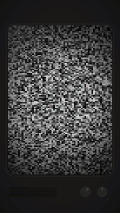<br>**signal-tune** |
| 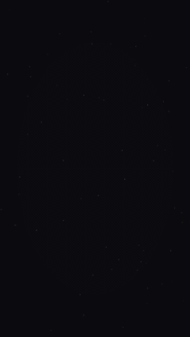<br>**orbit-ring** | 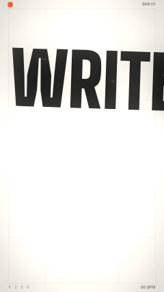<br>**beat-cut** | 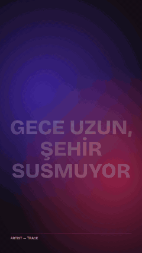<br>**lyric-video** |
| 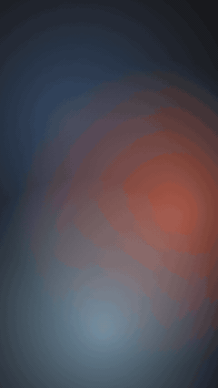<br>**captions** | 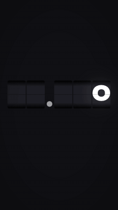<br>**odometer** | 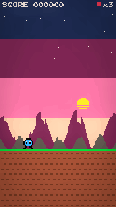<br>**pixel-quest** |
| 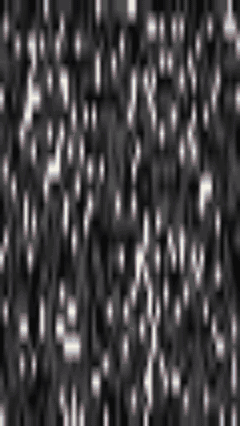<br>**vhs-memory** | 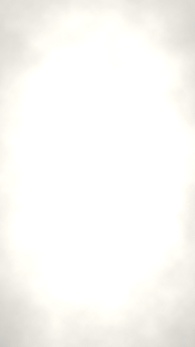<br>**image** · `--look sketch` | 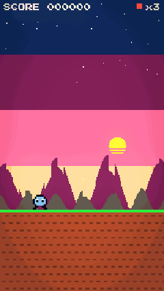<br>**transitions** |

## Maps

```bash
# auto picks globe / flat world / Turkey provinces from the distances
npx rudywizz-motion render map-route --set 'route=["İstanbul","Roma","Londra"]' --text "Avrupa Turu"
npx rudywizz-motion render map-route --set theme='"atlas"' --set 'route=["Söğüt","Bursa","Edirne","İstanbul"]' --text "Bir Beylikten Cihana"
npx rudywizz-motion render map-route --set 'route=["41.01,28.97", {"name":"Base camp","lat":27.98,"lon":86.92}]'
```
- Places: ~7,400 world cities, Turkey's 81 provinces, Turkish exonyms (*Londra, Viyana, Kudüs, Semerkant…*), landmarks (*Kapadokya, Efes, Göbeklitepe…*), or `"lat,lon"`.
- `mode`: `globe` · `flat` · `turkey` · `auto` — `theme`: `dark` · `atlas` · `light` — `icon`: `plane` · `ship` · `dot` — `highlight`: countries/provinces to tint.
- Combine with `--camera tilt-reveal` for a 3D tilted map.

## History pack

```bash
npx rudywizz-motion render history-short          # template: year card → atlas route → engraving → letter
npx rudywizz-motion render history-title --text "1453 / İstanbul'un Fethi / Bir çağın sonu" --grade sepia --film 0.6
npx rudywizz-motion render image --image painting.jpg --look engrave --camera push-in --grade sepia --film 0.6 --duration 6
npx rudywizz-motion render parchment-letter --text "Sevgili kardeşim, …" --set place='"Selanik, 1897"' --set signature='"Ahmet"'
```
The `engrave` look runs on the GPU: edges are inked first, cross-hatching follows the shadows, then a sepia wash fills in. Works on any portrait, painting or photo you have the rights to. `sketch`, `oldphoto`, `duotone`, `halftone`, `noir` are there too.

## Reels from your footage

```json
{
  "lang": "tr",
  "look": { "grade": "teal-orange", "bloom": 0.3, "leak": 0.2, "grain": 0.04 },
  "scenes": [
    { "style": "map-route", "route": ["İstanbul", "Kaş"], "duration": 5,
      "transition": { "type": "whip", "duration": 0.45 } },
    { "clip": "drone.mp4", "in": 4, "duration": 3, "speed": "ramp-mid", "camera": "punch-in",
      "overlay": { "style": "captions", "text": "Kaş, Antalya" },
      "transition": { "type": "burn", "duration": 0.8 } },
    { "layers": [ { "src": "sky.png", "depth": 0 }, { "src": "me.png", "depth": 1 } ],
      "duration": 3, "camera": "orbit" },
    { "style": "neon-sign", "text": "Yakında / görüşürüz", "duration": 3 }
  ]
}
```
```bash
npx rudywizz-motion render reel.json --audio song.mp3 --out reel.mp4
```
Or let Claude write it: `/reel 15 saniyelik gezi reel'i, bu 6 klipten, başta harita`.

## Templates

| Template | What |
|---|---|
| `tour` | 30 s showreel of styles, cameras and transitions |
| `history-short` | Sepia documentary: year card → atlas → engraving → letter |
| `travel-reel` | Globe flight → departures board → distance counter → neon sign-off |
| `lyric-teaser` | On-beat stamped words → lyric lines → VHS outro (bring your track) |
| `launch` | TV tune-in → orbiting feature rings → chrome reveal → risograph sign-off |

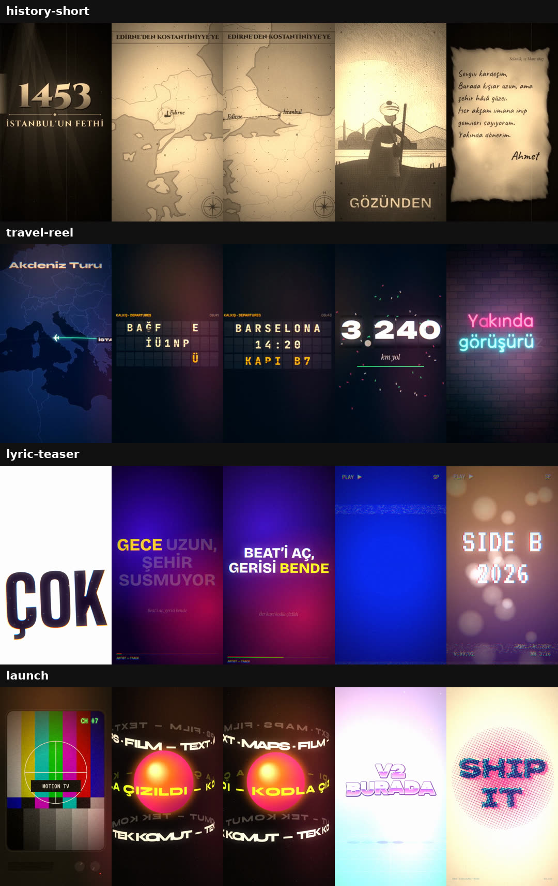

## Reference

```text
rudywizz-motion list | templates | doctor
rudywizz-motion render  <style|comp.json|template|image|clip> [options]
rudywizz-motion still   <…> --at <seconds>
rudywizz-motion preview <…>                 live loop in your browser
```

| Option | |
|---|---|
| `--text` | Text (`" / "` or `\n` for line breaks) |
| `--image` / `--clip` | Animate your own media |
| `--set key=value` · `--params file.json` | Style options (JSON values ok) |
| `--camera` | `static drift push-in pull-out punch-in crash-zoom whip-from-left whip-from-right whip-from-top spin-in rise orbit tilt-reveal tilt-left tilt-right vertigo handheld float beat-punch` |
| `--look` | `engrave sketch oldphoto duotone halftone posterize noir` |
| `--grade` | `teal-orange kodak fuji sepia noir bleach cyber sunset matte` |
| `--bloom --grain --leak --film --aberration --vignette` | Post effects, 0–1 |
| `--motion-blur n` | Sub-frames per frame (4–8 = filmic) |
| `--format` · `--size` | `9:16` (default) `1:1` `4:5` `16:9` · short side px |
| `--out` | `.mp4` · `.mov` (ProRes 4444 + alpha) · `.webm` (VP9 + alpha) · `.gif` |
| `--alpha` · `--audio` · `--bpm` · `--lang` · `--seed` · `--fps` · `--duration` | |

Transitions (composition JSON): `fade flash dip whip zoom spin glitch ink burn liquid iris wipe blinds pixelate leak cube ripple doors stretch luma`.
Full composition schema and the agent workflow: [`skills/rudywizz-motion/SKILL.md`](skills/rudywizz-motion/SKILL.md).

## How it works

```text
composition JSON ──► timeline (scenes, overlaps, speed ramps)
                         │
   style.js / image / clip ──► 2D canvas per scene  (fonts, data, layout)
                         │
                 WebGL2 compositor
   look filter ─► camera (+ camera blur) ─► transition ─► bloom ─► grade/lens/film/grain
                         │
        headless Chromium screenshot, frame by frame ──► ffmpeg ──► mp4 / mov / webm / gif
```
Rendering is CPU-friendly but not instant: roughly 0.2–0.5 s per 1080p frame on a laptop (GPU machines are faster). Draft with `--size 540`.

## Add a style

A style is one file, `skills/rudywizz-motion/styles/<id>/style.js`:
```js
export default {
  id: 'my-style', title: 'My Style', tagline: 'One line about it',
  fonts: [['Fraunces', 900]],
  defaults: { text: 'Hello', duration: 5, ink: '#fff' },
  options: { ink: 'Text colour' },
  setup(api) { /* layout once, return state */ },
  frame(api, t, state) { api.bg('#111'); /* draw frame at time t with api.ctx */ },
};
```
Then `npm run skills` generates its `/my-style` command. See [CONTRIBUTING.md](CONTRIBUTING.md).

## Credits

Made by [Rudywizz](https://github.com/Rudywizz). Fonts: SIL OFL via Fontsource. Maps: Natural Earth (public domain) via world-atlas. Projections: d3-geo. Demo illustrations in `assets/demo` are original and CC0.
Use images and clips you have the rights to. MIT licensed.
