<div align="center">

<h1>
  <picture>
    <source media="(prefers-color-scheme: dark)" srcset=".github/logo/logo-dark.svg">
    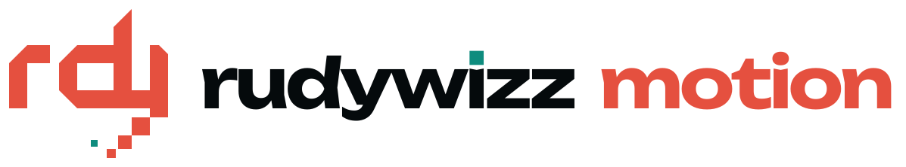
  </picture>
</h1>

**Koddan render edilen sinematik motion graphics.**

Kinetik tipografi · 3D başlıklar · harita uçuşları · alt yazı bantları, altyazılar ve sohbet hikâyeleri · sepya tarih belgeselleri · kendi çekimlerinden reels — <br>
gerçek kamera hareketleri, 20 shader geçişi, film tadında renk ve motion blur ile.

[](https://github.com/Rudywizz/rudywizz-motion/actions/workflows/ci.yml)
[](LICENSE)


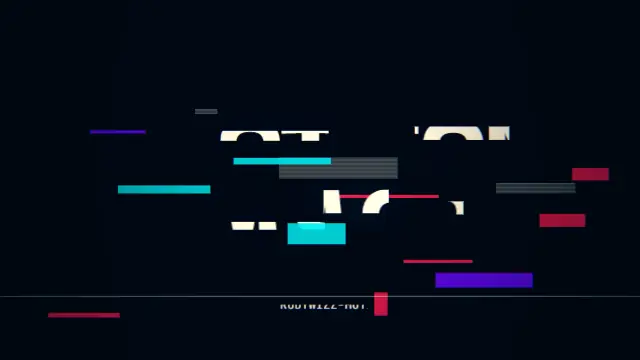

**Bir CLI ve bir dizi ajan skill'i.** Tek komut → MP4, kurgu programın için şeffaf MOV/WebM, GIF ya da animasyonlu WebP.<br>
After Effects yok, satın alınacak şablon yok, yapay zekâ video modeli yok: her kare kodla çiziliyor, aynı girdi her seferinde aynı videoyu verir.

**[Web sitesi ve canlı galeri](https://rudywizz.github.io/rudywizz-motion/)** · [Galeri](#galeri) · [Kurulum](#kurulum) · [Hızlı başlangıç](#hızlı-başlangıç) · [Şablonlar](#şablonlar) · [Ajanlar](#claude-code-ya-da-başka-bir-ajanla) · [Referans](#referans) · [English](README.md)

</div>

---

## Galeri

36 stil. Aşağıdaki her önizleme `npm run gallery` ile üretilmiş gerçek bir render.

### Kinetik tipografi

| | | |
|:-:|:-:|:-:|
| 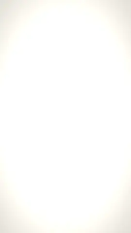<br>**word-stack** | 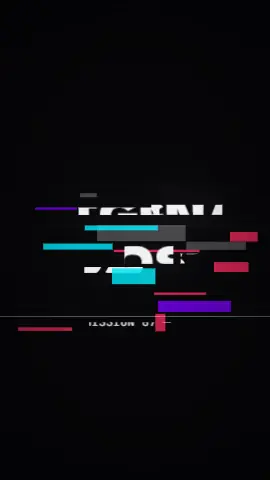<br>**glitch-title** | 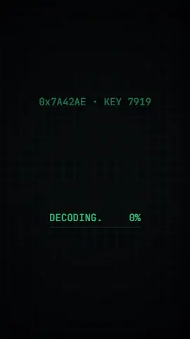<br>**scramble** |
| 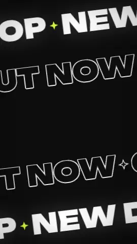<br>**ticker-rows** | 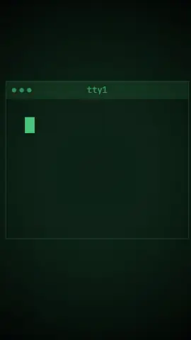<br>**typewriter** | 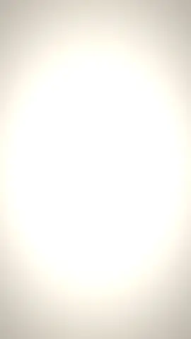<br>**highlight-quote** |
| 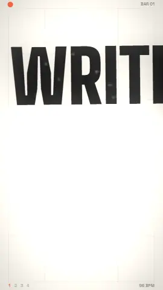<br>**beat-cut** | 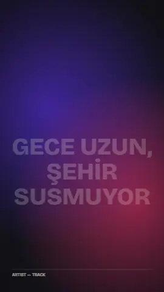<br>**lyric-video** | 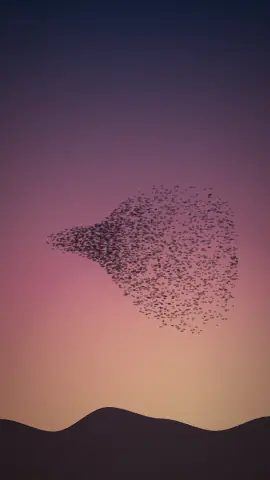<br>**murmuration** |
| 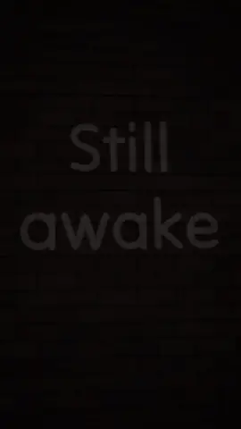<br>**neon-sign** | 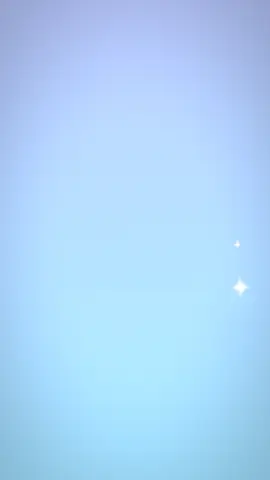<br>**inflate** | 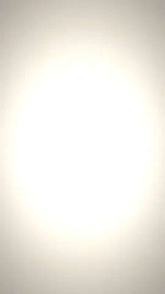<br>**ink-bleed** |
| 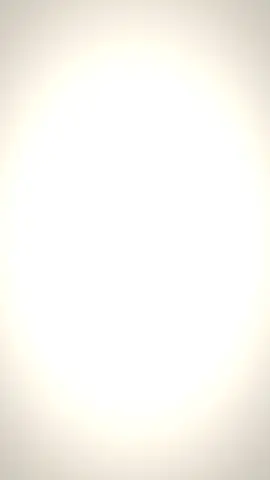<br>**halftone-press** | 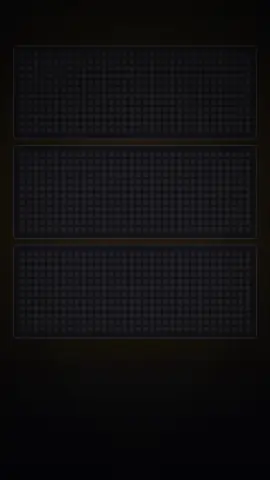<br>**led-marquee** | 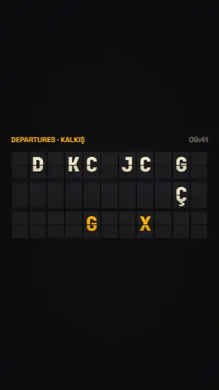<br>**split-flap** |
| 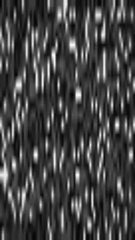<br>**vhs-memory** | 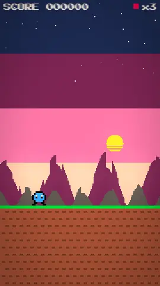<br>**pixel-quest** | 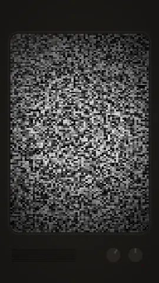<br>**signal-tune** |

### 3D

| | | |
|:-:|:-:|:-:|
| 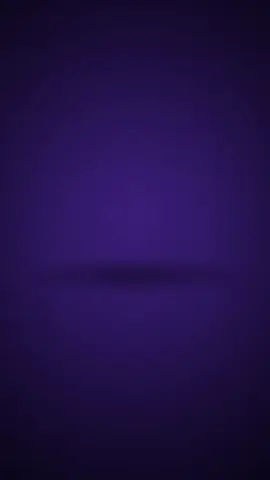<br>**extrude-3d** | 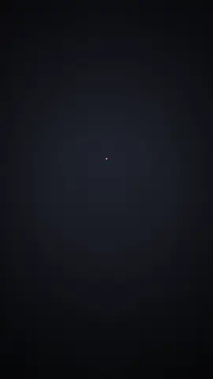<br>**cube-spin** | 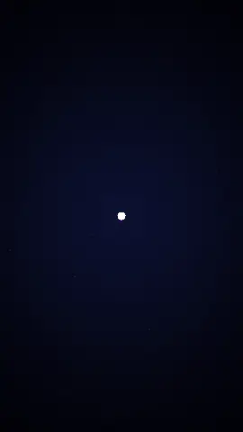<br>**particle-sphere** |
| 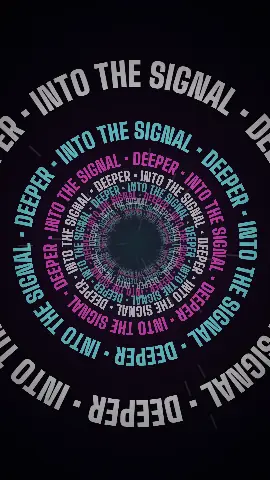<br>**text-tunnel** | 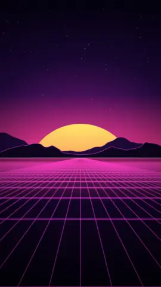<br>**retro-grid** | 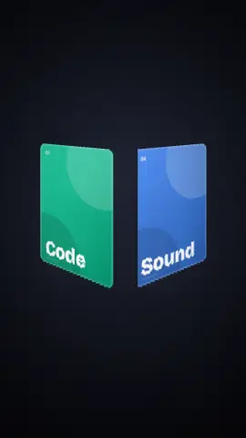<br>**card-carousel** |

Her stil kamerayla 3D uzaya da taşınabilir: `--camera orbit`, `tilt-reveal`, `tilt-left`, `vertigo`…

### Sosyal medya ve yayın

| | | |
|:-:|:-:|:-:|
| 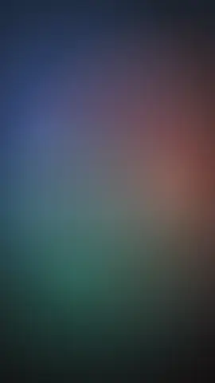<br>**lower-third** | 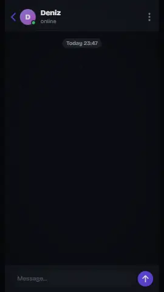<br>**chat-story** | 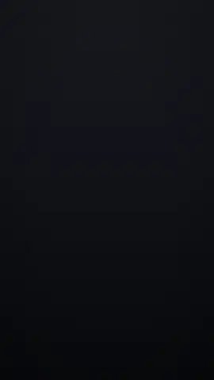<br>**bar-chart** |
| 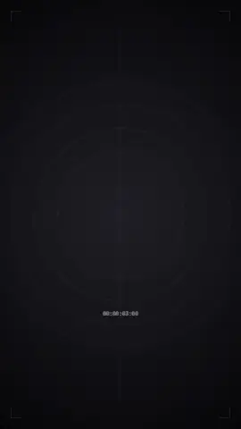<br>**countdown** | 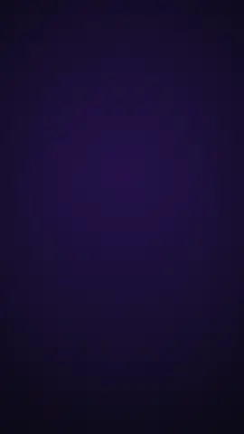<br>**cta-follow** | 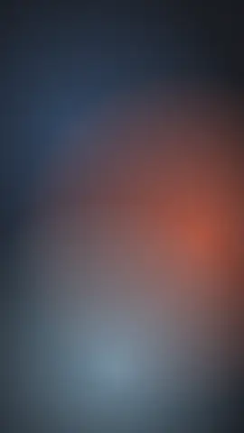<br>**captions** |
| 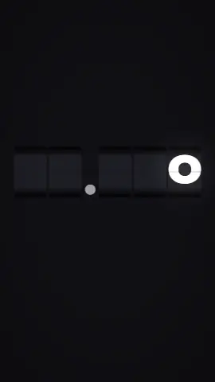<br>**odometer** | 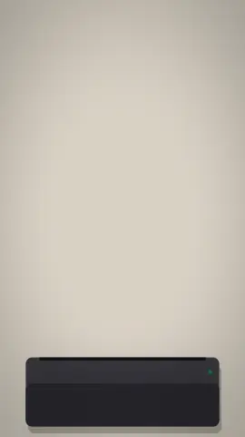<br>**receipt** | 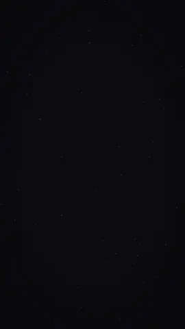<br>**orbit-ring** |

`--alpha --out isim.mov` ekle, çıkan dosyayı Premiere, Final Cut, DaVinci Resolve ya da CapCut'ta doğrudan görüntünün üstüne bırak.

### Haritalar, tarih ve kendi görsellerin

| | | |
|:-:|:-:|:-:|
| 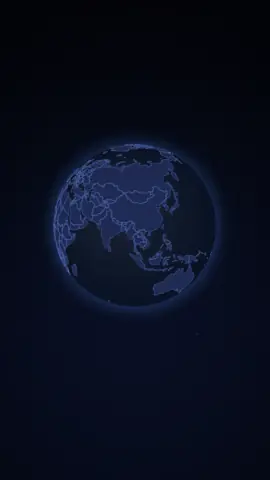<br>**map-route** · küre | 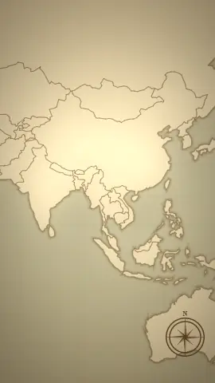<br>**map-route** · atlas | 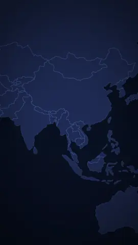<br>**map-route** · Türkiye |
| 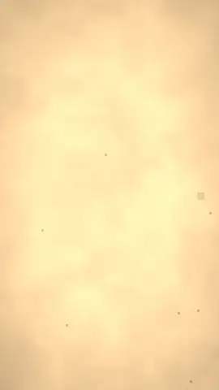<br>**image** · `--look engrave` | 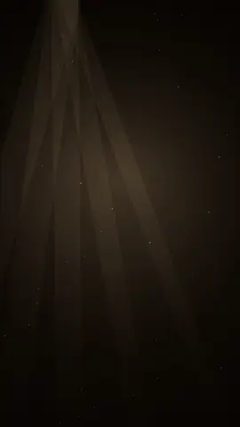<br>**history-title** | 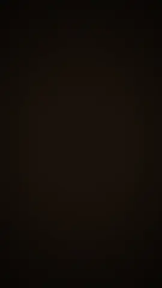<br>**parchment-letter** |
| 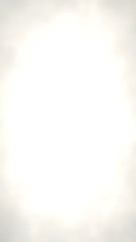<br>**image** · `--look sketch` | 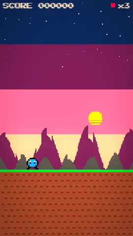<br>**20 geçiş** | |

## Neden farklı?

- **Kare kare, birebir aynı:** Her kare `t = kare / fps` ile hesaplanıp ffmpeg'e veriliyor. Ekran kaydı yok, kare atlama yok; aynı seed aynı videoyu verir (CI'da test ediliyor).
- **Gerçek bir compositor:** Her sahne kendi tuvalinde çiziliyor. Üstüne WebGL2 zinciri kamera, geçiş, bloom, lens, kromatik aberasyon, ışık sızıntısı, film hasarı ve renk grade'i ekliyor.
- **Motion blur'lu kamera:** 19 hareket var (punch-in, whip, orbit, tilt-reveal, vertigo, ritme oturan beat-punch…). Hızlı hareketler gerçek obtüratör gibi bulanıklaşıyor.
- **Her format:** 9:16, 1:1, 4:5, 16:9, istediğin boyutta. Metin sığdırılıyor, satıra bölünüyor, gerekirse heceleniyor; kadrajdan asla taşmıyor.
- **Çevrimdışı haritalar:** Dünya küresi, düz dünya haritası ve Türkiye'nin 81 ili. Şehir adlarını yaz, uçuş animasyonu hazır.
- **Kendi çekimlerin:** Klip ve fotoğraflarına hız rampası, el kamerası, altyazı, parallax katmanları ve grade.
- **Önce Unicode:** Gelen 17 fontun hepsi Latin Extended'ı destekliyor (ğ ş ı İ ç ö ü…). Büyük harf çevirme dile duyarlı (`i → İ`).

## Kurulum

**Node 18+** ve **ffmpeg** gerekir (macOS `brew install ffmpeg` · Windows `winget install ffmpeg` · Linux `sudo apt install ffmpeg`).

**CLI**
```bash
git clone https://github.com/Rudywizz/rudywizz-motion && cd rudywizz-motion
npm install
npx playwright install chromium     # tek seferlik; ya da kurulu Chrome/Edge kullanılır
npx rudywizz-motion doctor          # Node ✓  ffmpeg ✓  tarayıcı ✓  WebGL2 ✓
```

**Claude Code eklentisi**
```text
/plugin marketplace add Rudywizz/rudywizz-motion
/plugin install rudywizz-motion@rudywizz
```

**Skill okuyan her ajan** (Claude Code, Codex, Cursor…)
```bash
npx skills add Rudywizz/rudywizz-motion
```

## Hızlı başlangıç

```bash
npx rudywizz-motion render glitch-title --text "Sinyal / kayıp" --grade cyber
npx rudywizz-motion render extrude-3d --text "Büyük / haber" --format 16:9
npx rudywizz-motion render lower-third --text "Deniz Aydın / Sunucu" --alpha --out isim.mov
npx rudywizz-motion render map-route --set 'route=["İstanbul","Kapadokya","Antalya"]' --text "Rota"
npx rudywizz-motion render image --image portre.jpg --look engrave --grade sepia --film 0.6
npx rudywizz-motion render stats-recap          # hazır bir şablonun tamamı
npx rudywizz-motion preview neon-sign           # tarayıcıda canlı önizleme
```

Taslakları `--size 540` ile hızlıca al, son hâli varsayılan 1080'de render et.

> **Windows (PowerShell / cmd):** komut satırında JSON tırnaklamak zahmetli. Seçenekleri bir dosyaya yazıp
> `--params secenekler.json` ver ya da `npx rudywizz-motion init` ile bir kompozisyon dosyası oluştur.

## Şablonlar

`npx rudywizz-motion templates` listeler; adıyla render et ya da JSON'unu kopyalayıp düzenle.

| Şablon | Ne yapar | Format |
|---|---|---|
| `showreel` | Yukarıdaki vitrin: kinetik tipografi, 3D, harita ve geçişler | 16:9 |
| `kinetic-promo` | Glitch açılış → iki yana yaslı kelime yığını → şifre çözme → kayan poster satırları | 9:16 |
| `3d-title` | 3D başlık → dönen küp → parçacık küresi → synthwave kapanış | 16:9 |
| `youtube-intro` | Şifre çözen başlık → kelime yığını → sunucu alt bandı | 16:9 |
| `stats-recap` | Geri sayım → dönen büyük sayı → bar chart yarışı → takip butonu | 9:16 |
| `chat-reel` | Bir sohbet akar → glitch'li sürpriz → takip çağrısı | 9:16 |
| `quote-card` | Fosforlu kalemle vurgulanan alıntı kartı | 4:5 |
| `event-countdown` | 3·2·1 → tarih ve yerle kalkış panosu → neon kapanış | 9:16 |
| `travel-reel` | Küre üstünde uçuş → kalkış panosu → mesafe sayacı → neon kapanış | 9:16 |
| `history-short` | Sepya belgesel: yıl kartı → atlas → gravür → mektup | 9:16 |
| `lyric-teaser` | Ritme oturan kelimeler → şarkı sözü satırları → VHS kapanış (parçanı ekle) | 9:16 |
| `launch` | TV açılışı → dönen özellik halkaları → krom açılış → risograf kapanış | 9:16 |
| `tour` | Orijinal stillerin 30 saniyelik turu | 9:16 |

## Kendi çekimlerinden reel

```json
{
  "$schema": "https://raw.githubusercontent.com/Rudywizz/rudywizz-motion/main/skills/rudywizz-motion/schema/composition.schema.json",
  "lang": "tr",
  "look": { "grade": "teal-orange", "bloom": 0.3, "leak": 0.2 },
  "scenes": [
    { "style": "map-route", "route": ["İstanbul", "Kaş"], "duration": 5, "transition": { "type": "whip", "duration": 0.45 } },
    { "clip": "drone.mp4", "in": 4, "duration": 3, "speed": "ramp-mid", "camera": "punch-in",
      "overlay": { "style": "captions", "text": "Kaş, Antalya" }, "transition": { "type": "burn", "duration": 0.8 } },
    { "style": "neon-sign", "text": "Yakında / görüşürüz", "duration": 3 }
  ]
}
```
```bash
npx rudywizz-motion render reel.json --audio parca.mp3 --out reel.mp4
```
`$schema` satırı sayesinde VS Code ve diğer editörler her stil seçeneğini otomatik tamamlar.
Yazım hataları render'dan önce yakalanır: `unknown camera "orbt". Did you mean "orbit"?`

## Claude Code ya da başka bir ajanla

Eklentiyi kurduktan sonra sadece iste:

> *bu kliplerden 15 sn'lik bir reel yap, başta İstanbul → Roma harita intro olsun*<br>
> *kanalım "Haftalık Kod" için 16:9 bir YouTube intro'su, glitch'li olsun, sonunda adımla alt bant*<br>
> *şu rakamlarla dikey bir bar chart yarışı, sonunda takip butonu*

Ya da bir skill'i doğrudan çağır: `/rudywizz-motion:glitch-title Sinyal kayıp`, `/rudywizz-motion:reel`, `/rudywizz-motion:history-video 1071 Malazgirt`.
Ajan render'dan önce kontrol kareleri alır, böylece yerleşim sorunları erkenden yakalanır.

## Referans

```text
rudywizz-motion list | templates | doctor | init [dosya] | --version
rudywizz-motion render  <stil|şablon|comp.json|image|clip> [seçenekler]
rudywizz-motion still   <…> --at <saniye>
rudywizz-motion preview <…>
```

| Seçenek | |
|---|---|
| `--text` | Metin (satır sonu için `" / "` ya da `\n`) |
| `--image` / `--clip` | Kendi görsel ya da klibini canlandır |
| `--set anahtar=değer` · `--params dosya.json` | Stil seçenekleri (JSON değer olabilir) |
| `--camera` | `static drift push-in pull-out punch-in crash-zoom whip-from-left whip-from-right whip-from-top spin-in rise orbit tilt-reveal tilt-left tilt-right vertigo handheld float beat-punch` |
| `--look` | `engrave sketch oldphoto duotone halftone posterize noir` |
| `--grade` | `teal-orange kodak fuji sepia noir bleach cyber sunset matte` |
| `--bloom --grain --leak --film --aberration --vignette` | Efektler, 0–1 |
| `--motion-blur n` | Kare başına alt kare (4–8 = sinematik) |
| `--format` · `--size` | `9:16` (varsayılan) `1:1` `4:5` `16:9` · kısa kenar px |
| `--out` | `.mp4` · `.mov` (ProRes 4444 + alfa) · `.webm` (VP9 + alfa) · `.gif` · `.webp` |
| `--alpha` · `--audio` · `--bpm` · `--lang` · `--seed` · `--fps` · `--duration` · `--strict` | |

Kompozisyon şeması ve ajan iş akışının tamamı: [`skills/rudywizz-motion/SKILL.md`](skills/rudywizz-motion/SKILL.md).

## Güvenle çalıştır

- **Ağ yok, telemetri yok.** Render sırasında hiçbir şey yüklenmez ya da indirilmez; fontlar, haritalar ve veriler repoyla gelir.
- **Tek bağımlılık:** Playwright (Microsoft). Motor, derleme adımı olmayan, okunabilir düz JavaScript.
- Render sunucusu yalnızca `127.0.0.1`'i dinler, her çalıştırmada rastgele bir anahtarla korunur ve render bitince kapanır.
- Ayrıntılar ve gizli güvenlik bildirimi: [SECURITY.md](SECURITY.md).


rudywizz-motion sana After Effects başında bir akşam kazandırdıysa, bir ⭐ başkalarının da bulmasına yardım eder.

## Katkı

Bir stil tek bir dosyadır. Nasıl ekleneceği [CONTRIBUTING.md](CONTRIBUTING.md) içinde anlatılıyor. Fikirlerini [issue](https://github.com/Rudywizz/rudywizz-motion/issues/new/choose) olarak açabilirsin; Türkçe de yazabilirsin.

## Lisans

[MIT](LICENSE): kişisel ve ticari kullanım serbest. Hazırlayan: [Rudywizz](https://github.com/Rudywizz).
Fontlar SIL OFL (Fontsource), harita verisi Natural Earth (kamu malı). Demo çizimleri ve galeri CC0.
Tam liste: [THIRD_PARTY_NOTICES.md](THIRD_PARTY_NOTICES.md). Kullanım hakkına sahip olduğun görsel ve klipleri kullan.
